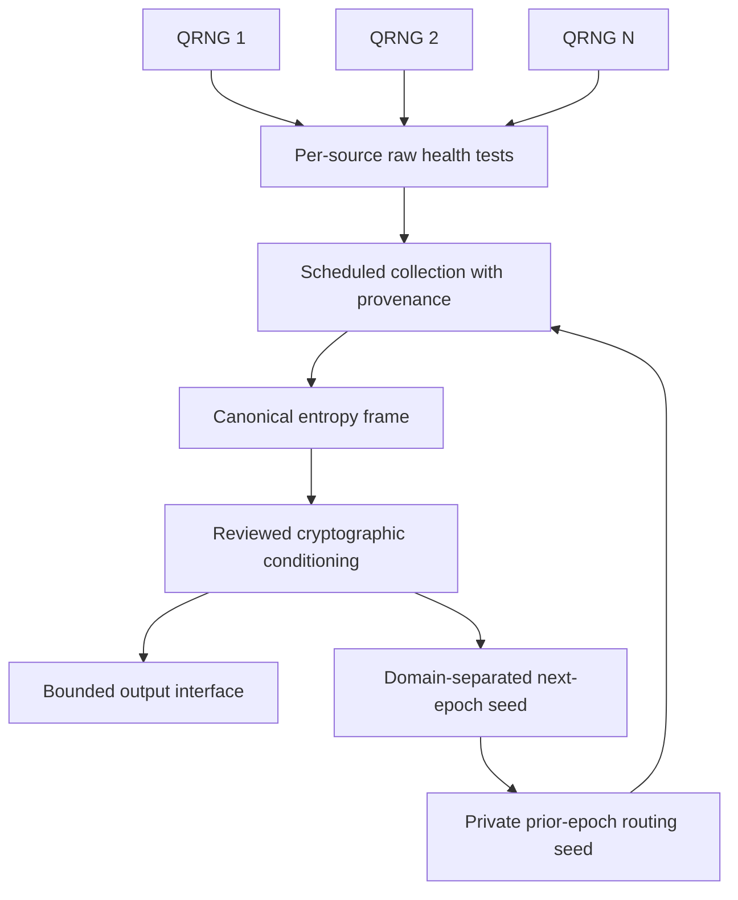

# Uribe Arroyo Quantum Dynamic Routing (UAQDR)

**A proposed feedback-controlled, multi-source quantum entropy architecture**

**Author:** Esteban Uribe Arroyo  
**Version:** Technical research draft v0.1 — November 13, 2026  
**Status:** Proposed design; not implemented, security-reviewed, NIST-validated, or peer-reviewed.

> **Research hypothesis, not an established security product.** UAQDR explores whether multiple monitored QRNG sources plus quantum-derived feedback-controlled routing can yield measurable improvements in resilience or leakage properties over matched static acquisition methods. Dynamic routing does not generate entropy or guarantee protection against side channels.

## Overview

Traditional entropy-acquisition pipelines often use a fixed read order or a predetermined source-selection policy. UAQDR proposes a multi-QRNG collection system where conditioned QRNG measurements contribute to a *confidential control stream* that determines the schedule of later QRNG reads. Accepted raw samples feed a carefully framed conditioning pipeline, while separate derived outputs supply the next routing state and externally consumed random bits.

### High-level architecture

## Scientific scope

| Claim | Status |
|---|---|
| Multiple QRNG inputs are part of the proposed design | Defined in draft |
| Routing decisions are derived from prior accepted quantum measurements | Defined in draft |
| Source health should be tested before conditioning | Design requirement |
| Routing improves min-entropy or prevents reverse engineering | **Not demonstrated** |
| Dynamic schedule defeats timing / power-trace analysis | **Not demonstrated** |
| Complies with / certified under NIST SP 800-90B or 90C | **Not claimed** |
| Novelty beyond prior entropy-pooling and random-routing literature | **Not established** |

## Research files

- **[Six-page whitepaper PDF](paper/UAQDR_Whitepaper_v0.1.pdf)** — searchable, formatted technical draft (not peer reviewed).
- **[Whitepaper v0.1](paper/UAQDR_Whitepaper_v0.1.md)** — abstract, proposed architecture, mathematical model, trust assumptions, threat model, related work, validation plan, and references.
- **[Publication guide](PUBLISHING.md)** — step-by-step steps for Zenodo, GitHub Pages, sitemap submission, and scholarly indexing.
- **[Static website](docs/index.html)** — responsive GitHub Pages project website with metadata, visible abstract, author details, and structured data.
- **[Scholar abstract page](docs/paper.html)** — distinct publication landing page with scholar-friendly bibliographic metadata.

## Proposed experimental method

1. Characterize each QRNG source with raw measurement data and NIST SP 800-90B-informed tests.
2. Implement one-source, static multi-source, independent-random-routing, and feedback-routed variants.
3. Match the sources, sample budget, conditioner, environmental controls, and output limits.
4. Analyze conditional min-entropy assumptions, failure response, correlation, timing, energy, and leakage.
5. Publish both positive and negative results with reproducible scripts and device descriptions.

The implementation and experimental evidence have **not** been created by this repository template.

## Technical references

- [NIST SP 800-90B — Entropy Sources](https://doi.org/10.6028/NIST.SP.800-90B)
- [NIST SP 800-90C — Random Bit Generator Constructions (final 2025)](https://doi.org/10.6028/NIST.SP.800-90C)
- [NIST SP 800-90A Rev. 1 — Deterministic Random Bit Generators](https://doi.org/10.6028/NIST.SP.800-90Ar1)
- [Quantum randomness extraction — Physical Review A (2013)](https://doi.org/10.1103/PhysRevA.87.062327)

## Citation

**Pending formal publication.** Do not cite a nonexistent DOI. Suggested provisional reference:

> Uribe Arroyo, Esteban (2026). *Uribe Arroyo Quantum Dynamic Routing (UAQDR): A Proposed Feedback-Controlled, Multi-Source Quantum Entropy Architecture*. Technical research draft, version 0.1.

## Publication status and author attribution

UAQDR is a research proposal by **Esteban Uribe Arroyo**. A DOI, independent review, and published experimental results will be added if and when they exist. Names, versions, and contributions should be updated transparently; authorship attribution is not evidence of validation or invention priority.

## Licensing

**License not yet selected.** See `PUBLISHING.md` before redistributing or accepting contributions. No open-source permission is implied by the absence of a license.
